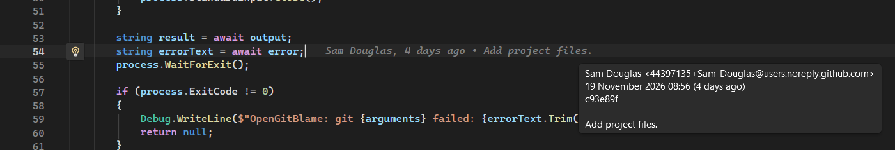

# Inline Git Blame

Inline Git Blame shows who last changed the line you're on, and when, faded out at the end of the
line. Hover over the message for the full author, date, commit hash and message.

Lines you've changed but not committed show as *You, uncommitted changes*. The blame follows your
edits as you type, and refreshes when you save or come back to Visual Studio after committing
elsewhere.

## Commands

Find these on the editor's right-click menu and under **Extensions > Inline Git Blame**.

| Command | What it does |
|---|---|
| **Open Line Commit in Browser** | Opens the current line's commit on GitHub, GitLab, Bitbucket or Azure DevOps. |
| **Copy Line Commit Hash** | Copies the current line's full commit hash to the clipboard. |

## Settings

Find these under **Extensions > Inline Git Blame** or **Tools > Options > Inline Git Blame**.
Defaults are in brackets.

| Setting | What it does |
|---|---|
| **Enabled** (on) | Turns the extension on or off. When off, no blame is shown, git isn't run and the commands above are greyed out. |
| **Message format** (`{author}, {ago} • {summary}`) | The text shown after the line. Use `{author}`, `{email}`, `{date}`, `{ago}`, `{summary}` and `{hash}` to build your own, e.g. `{hash} {author}, {date}`. |
